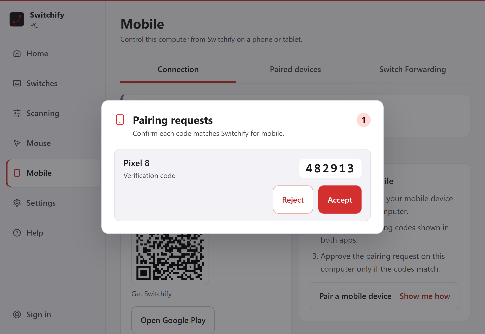

If you use Switchify on an Android phone or tablet, you can pair it with Switchify PC. Then you can control the computer from the phone with [PC control](/android/pc-control/), or send the switches connected to the phone to the computer with [Switch Forwarding](/android/switch-forwarding/).

Pairing is optional. Switchify PC works on its own with switches connected to the computer.

In places, Switchify PC calls the phone **Remote** or **Switchify Remote**, for example in the Switches settings. That means the Switchify app on your phone or tablet.

Built-in PC control arrives with Switchify 3.1, which is still in testing and not yet on Google Play; Switchify PC 1.0 is a release candidate.

## What you need

- Switchify PC running on the computer, with Bluetooth on.
- Switchify on an Android 10 or later device with Bluetooth Low Energy. Get it from [Google Play](https://play.google.com/store/apps/details?id=com.enaboapps.switchify).

## Pair

1. On the Android device, open PC control in Switchify, choose **Find nearby PCs**, and pick this computer.
2. Both apps show a six-digit code. Compare them.
3. On the computer, choose **Accept** only if the codes match. If they differ, or you did not ask to pair, choose **Reject**.

   A pairing request expires after 2 minutes if nobody answers it. If the same phone asks again, the new request replaces the old one.

   

The computer now trusts that device. Switchify PC lists paired devices under **Mobile** > **Paired devices**, where you can **Forget** one at any time.

If both apps are signed in to the same Switchify account, Switchify PC can approve pairing automatically. Turn this on or off on the Account page.

## While a phone is connected

Connecting a phone pauses local scanning on the computer. Local scanning resumes when the phone disconnects.

The computer's Escape key is an emergency stop only while the phone's switches are running the computer's scanning (see [Remote scanning](/android/pc-control/#remote-scanning)). At other times, to stop the phone controlling the computer, choose **Disconnect** on Home, in the tray or menu bar, or on the phone.

Commands between the apps travel only over Bluetooth, never over the internet.
