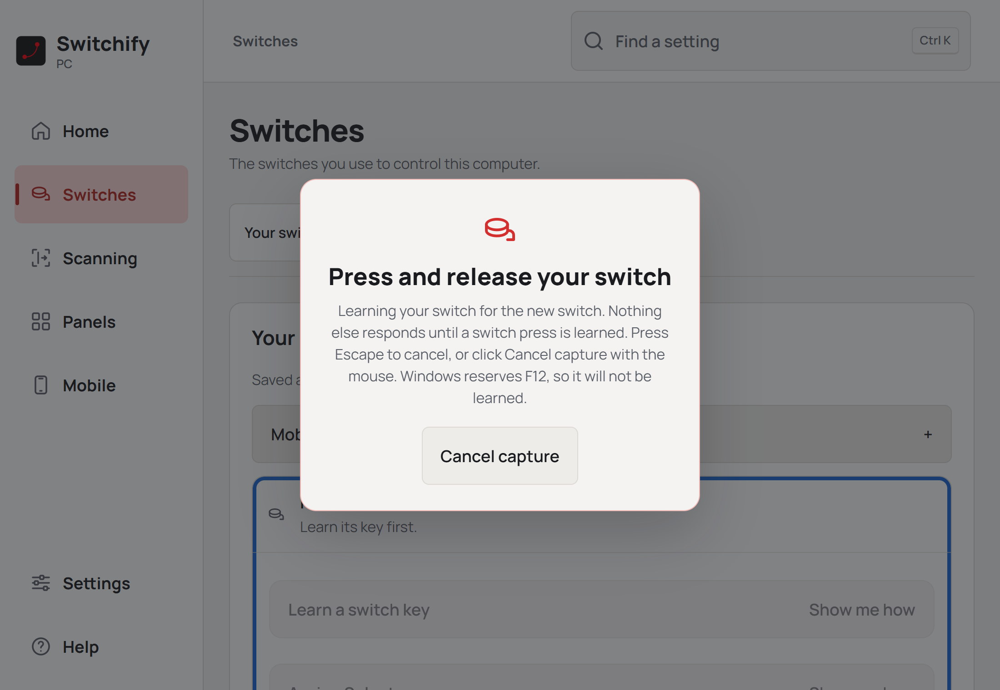
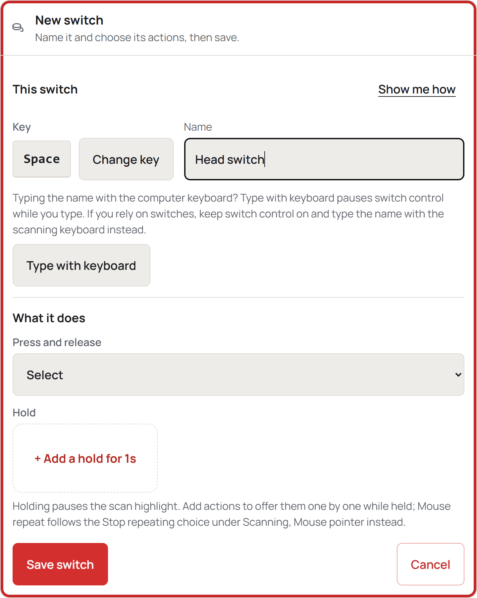
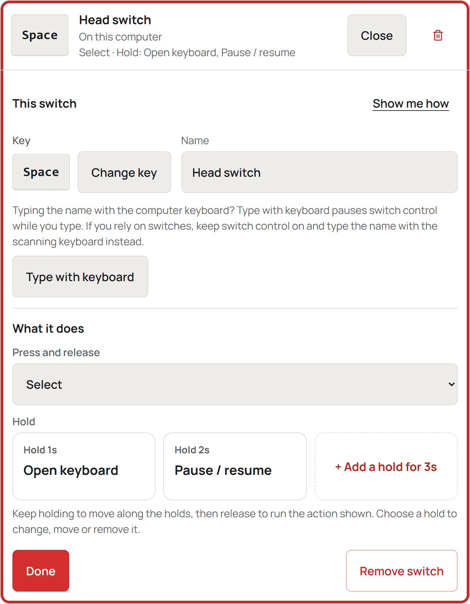

Switchify PC sees a switch as a key press or a gamepad button press. Anything that sends a key or a button when you press it will work: a switch interface with a 3.5 mm socket, a USB switch, a keyboard key, or a game controller.

## Connect the switch

**A jack switch.** Check which connector and socket your switch interface requires, push the plug fully into the interface, and connect the interface to the computer.

**A USB switch.** Connect it to a USB port. Plugging it in does not configure anything by itself; you still add it below.

**Choose a keyboard or gamepad mode on your interface.** Most interfaces have a mode setting. Mouse-click modes cannot be learned, so Switchify PC sees nothing when you press. In keyboard mode most interfaces send Space or Enter, and Switchify PC learns those. If your interface can be programmed, set it to F13 or higher (F13 to F20 on a Mac). Nothing else on the computer types those keys, so they never clash. F12 is reserved on Windows and cannot be used.

**Gamepad mode.** Interfaces such as the Smartbox Joycable, the Pretorian USB Switch and the Crick USB Switch Box can send gamepad buttons instead of keys, and so can a game controller, such as the Xbox Adaptive Controller on Windows. Switchify PC learns buttons 1 to 8 and shows them as *Gamepad 1* to *Gamepad 8*. Button 1 on any connected controller counts as the same switch. Gamepad buttons never type anything, so they cannot clash with the keyboard. Sticks, triggers and the direction pad are not switches.

## Learn the key

1. Choose the **Switches** tile at the top of the window, then **Add switch**.
2. Press and release your switch once. The key or gamepad button it sends appears as a badge.

   

3. Give the switch a name, such as *Head switch* or *Foot pedal*, choose what a press does, and choose **Save switch**.

   

While the learning dialog is open it holds keyboard focus, so a press cannot scroll Settings or activate a button. Press Escape to cancel. If you need to type the name with the keyboard, choose **Type with keyboard** under the name, which pauses switch control while you do. **Show me how** at the top of the editor shows how to learn a switch and how to select with one.

Each key belongs to one switch, but several switches can run the same action.

## Choose what a press does

The action list is split under headings, so related actions sit together. Give the switch one of these actions for a **press and release**:

- **Scanning**
  - **Select** chooses the highlighted item. Automatic scanning needs one switch set to Select.
  - **Next** and **Previous** step through items. Manual scanning needs Select, Next and Previous.
  - **Reverse direction**, **Pause / resume**, **Stop scanning**.
  - **Auto select on / off** turns point scanning's [Auto select](/using/point-scanning/#auto-select) on or off.
- **Mouse**
  - **Left click at the pointer** clicks wherever the pointer is, with no point scan or menu. It works while scanning runs and while it waits for Select. See [Clicking](/using/mouse-panel/#clicking) for when scanning stays where it was and when it doesn't click.
  - **Move in blocks on / off** turns the mouse panel's [Move in blocks](/using/mouse-panel/#move-in-blocks) on or off.
- **Open a panel**: **Keyboard**, **Point** or **Mouse** jumps straight to that mode.
- **Open a menu**: a built-in menu, such as **Home** or **Editing**. **Scanning settings** opens the Scanning menu.
- **My panels**: your saved custom panels. This heading appears once you have saved one.

The same choices are available for hold actions and forwarded switches. Elsewhere, such as the switch list, an action shows its full name, like *Open Home* or *Open keyboard*.

The action runs when you release. Scanning movement freezes while any switch is held, so a slow release never selects the wrong thing.

To change a saved switch later, choose **Edit** next to it on the Switches page.

## Hold actions

A switch can also have an ordered list of **hold actions**. Keep the switch down and each action is offered in turn on screen, one per interval. Release while an action is offered to run it. The interval is 1 second by default. Set it under **More options** on the Switches page, in **Hold timing**, with **Hold action interval**: use **−** and **+** to set it from 0.25 to 5 seconds, 0.05 seconds at a time. Holding on its own never runs anything; only the release does.

To open a panel with a hold, add a hold and pick the panel under **Open a panel**, **Open a menu** or **My panels**. Create and save custom panels on the **Panels** page first. Opening a menu or custom panel starts its scan, including when scanning was waiting or paused. Back returns to Home. If a custom panel is deleted, replace its unavailable assignment in the switch editor.

In the switch editor, hold actions are tiles under **Hold**, in the order holding reaches them. Each tile shows how long to hold and the action, such as *Hold 1s, Open keyboard*. The last tile, **Add a hold for…**, adds another and opens it ready to change.

Choose a tile to open its panel. There you can pick a different **Action**, **Move earlier** or **Move later** to change the order, or **Remove** it. **Close** closes the panel.

## Press timing

If a switch gets pressed by accident, or one press selects twice, change these under **More options** on the Switches page, in **Press timing**. Both are off to begin with. Use **−** and **+** to change them 0.05 seconds at a time.

- **Hold before a press counts**: off, or up to 2 seconds. A press released sooner than this does nothing, so a tremor or a brief bump is ignored. Hold action timing starts once the press counts, so each hold action takes that much longer, and the emergency stop can too; Settings shows the exact times.
- **Ignore presses after a press**: off, or up to 3 seconds. After a press that counts, any switch pressed within this time does nothing. The time starts when you release the switch. This stops a switch that bounces, or a quick second press, from selecting again.

These apply to switches connected to the computer, not to switches forwarded from Switchify Remote. Escape and the emergency stop below still work.

## Emergency stop

Press **Escape**, or hold any switch for at least 4 seconds (longer if that switch has a long hold list; Settings shows the exact time), to reset scanning. Switchify PC keeps the switch keys and waits for Select to start again.

## Use the switch key as a normal key

While a Select switch is saved, Switchify PC takes its key everywhere, so a switch set to Space cannot type a space in other apps. To hand the keys back for a while, choose **Pause listening** in the system tray on Windows or the menu bar on a Mac, or on the Home page under Saved switches. Your switches then do nothing in Switchify PC and the keys work as they normally would.

Choose **Resume listening** in the same places to take them back. Home shows **Listening paused** under Saved switches while listening is paused, and testing local switches waits until you resume. The pause lasts until you resume or restart Switchify PC, so the switches are always ready after a restart. Switchify on Android is not affected: a remote scanning session carries on, and the pause takes effect on the computer's own keys once it ends.

## On Windows

Switchify PC keeps capturing your switch keys while it is in the background or minimised, including when the key is pressed with Shift, Ctrl, Alt or Windows held. Keys you have not assigned pass through to whatever you are using. Switch control does not work on the Windows secure desktop, such as a UAC prompt.

## Confirming changes

When you remove a switch, the confirmation starts on **Keep switch**. Choose **Keep switch** to cancel removal. Tab and Shift+Tab stay within the dialog. While a change is saving, wait for it to finish before choosing another action.
