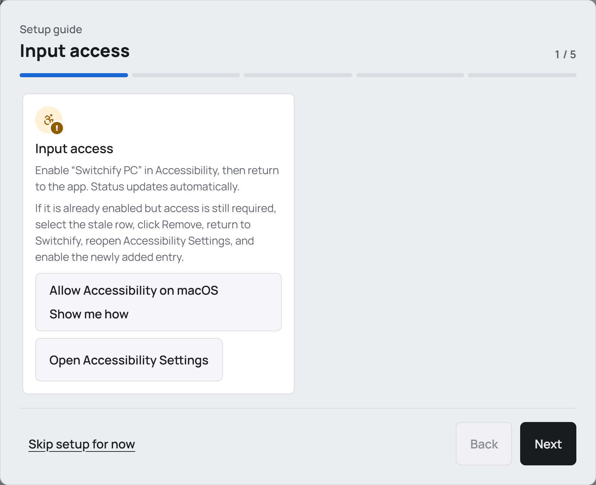
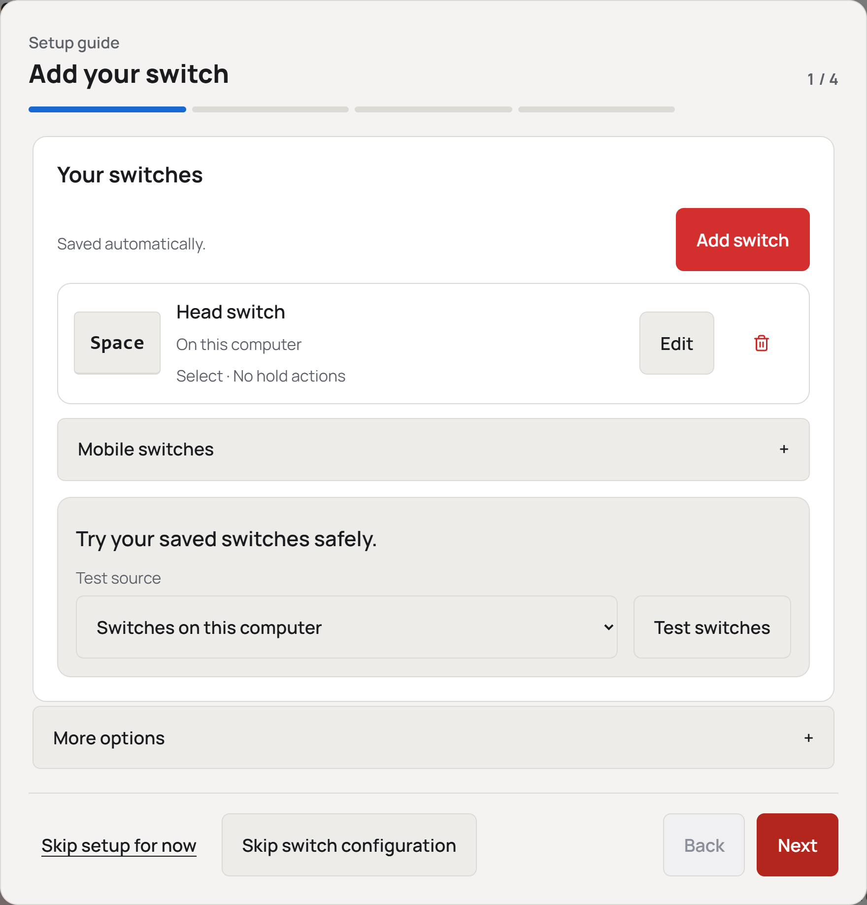
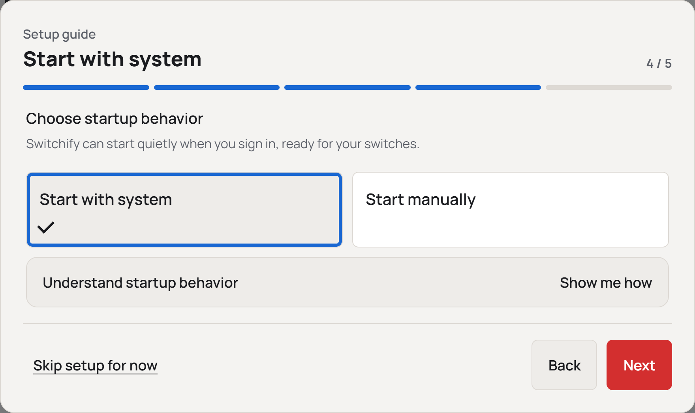
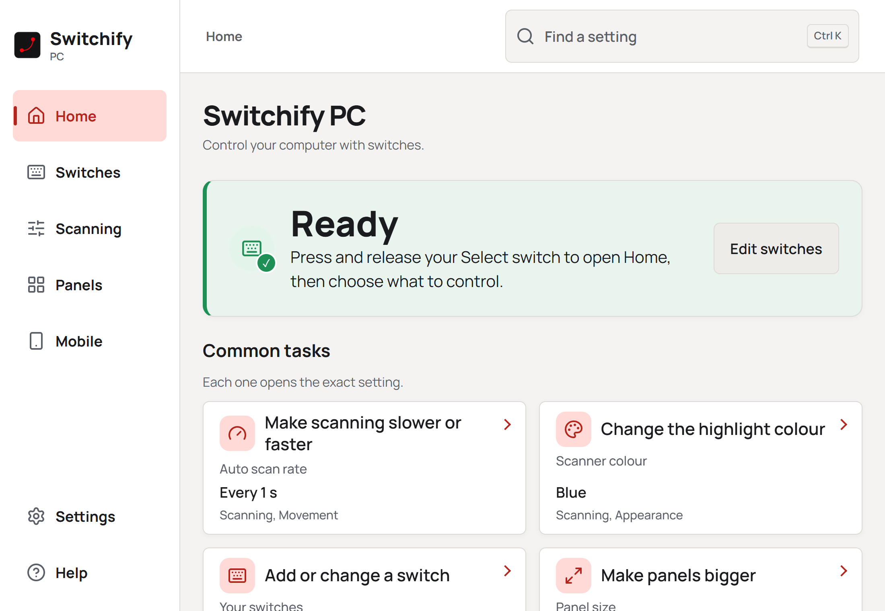
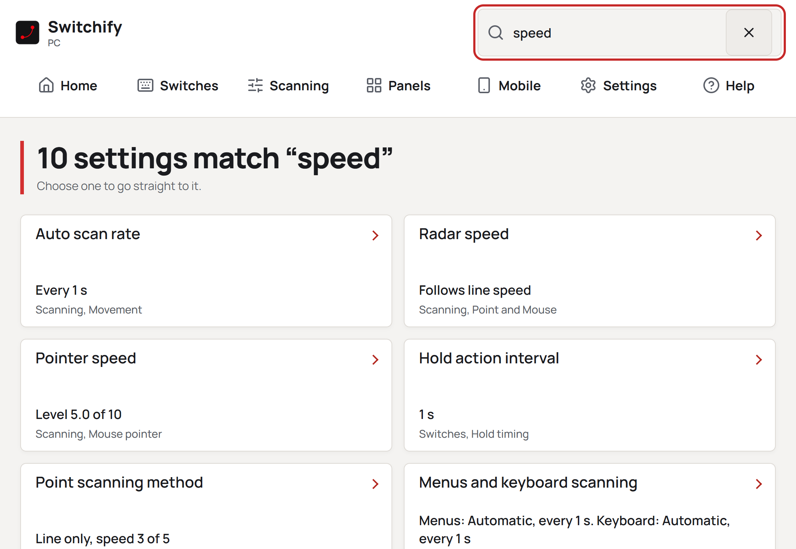

## What you need

- **Windows:** Windows 10 or later.
- **Mac:** A Mac with an M1 chip or later (Apple silicon) on macOS 13.3 or later. Intel Macs are not supported.
- **Bluetooth Low Energy**, only if you want to pair with Switchify on Android.
- **A switch** that reaches the computer as a key press, through a switch interface or a USB switch. See [Add a switch](/get-started/add-a-switch/).

Linux is not supported.

## Install

Download the latest release from [GitHub releases](https://github.com/switchifyapp/switchify-pc/releases).

- On Windows, run the installer.
- On a Mac, open the disk image and drag Switchify PC to Applications.

## Trial and upgrading to 1.4.0

Version 1.4.0 introduces a full 30-day trial and purchase licences for one
computer. If you upgrade from an earlier free release, your trial starts when
you first open the licensing-enabled app. You can see the days remaining in
the **Licence** section of Settings.

To continue after the trial, import your purchase email's licence attachment
or paste its key in that section. First activation needs an internet connection;
a Switchify account is not required. Each successful licence check then allows
up to 30 days offline. If that allowance ends, reconnect and choose **Check
licence now**. Settings and licence entry stay available when control is locked.
See [licences, activation and offline access](/licence/) for the full details.

## The setup guide

The first time Switchify PC opens, a five-step guide walks you through:

1. **Input access.** On a Mac, Switchify PC needs Accessibility permission to control the pointer and keyboard. Choose *Open Accessibility Settings*, turn on Switchify PC under Privacy & Security, then come back to the app. It checks again by itself when its window regains focus. On Windows this step shows *Ready*.

   

2. **Add your switch.** Choose **Add switch**, press your switch once so Switchify PC learns the key it sends, then name it. [Add a switch](/get-started/add-a-switch/) shows each part of this. **Next** turns on once a switch is saved. To set switches up later, choose **Skip switch configuration**.

   

3. **Scanning basics.** A short introduction to automatic scanning and the Home menu.
4. **Start with system.** Choose **Start with system** or **Start manually**. With Start with system, Switchify PC starts quietly when you sign in, in the system tray on Windows or the menu bar on a Mac.

   

5. **Anonymous diagnostics.** Choose **Share diagnostics** or **Don’t share**. Nothing is shared unless you choose to. See [Account, updates and privacy](/account-and-privacy/).

You can skip the guide with **Skip setup for now** and reopen it later from Help.

## When setup is done

Home shows **Ready** when Switchify PC is waiting for your switches. Press and release your Select switch to open the Home menu.

The pages of the app are a row of large tiles across the top of the window: Home, Switches, Scanning, Panels, Mobile, Settings and Help. In a narrow window the tiles wrap onto a second row. The current page, a chosen option and a setting that is on are all outlined in your own scanner colour and thickness, so the window looks the way the scan highlight will.

## Finding a setting

- **Find a setting** is the box beside the page tiles. Type a word such as *speed*, *colour*, *phone*, *switch* or *licence* and matching settings appear, each with the page and section it lives in and what it is set to now. Spelling does not have to be exact, and everyday words work: *phones*, *colr* or *quicker* still find the setting. Choose one to go straight to it; it is outlined for a moment so you can see where you landed. Pressing **/** puts the cursor in the box.
Find also understands what you mean: *my scan is too quick* finds Auto scan rate, and this runs on your computer with nothing sent anywhere.

- **On this page** is the row of tiles at the top of each page, one per section, showing what each section is set to. Choose one to scroll to that section.
- **Common tasks** on Home opens the settings people most often look for, such as making scanning slower or faster, changing the highlight colour, adding a switch or making panels bigger.
- **Recently changed** on Home lists the last settings you changed, so you can find them again. It starts empty each time the app opens.
- **Also see** at the end of each page lists related settings on other pages.

## Keeping it up to date

Switchify PC checks for an update shortly after it starts, every six hours, and whenever you ask. Settings shows what is available, downloads it, and offers *Install and restart*.

## Practise safely

Before you rely on a switch, open the switch practice area. Nothing in it clicks, types, or changes settings, so you can try presses, holds and scanning without side effects. It closes itself after two minutes.
