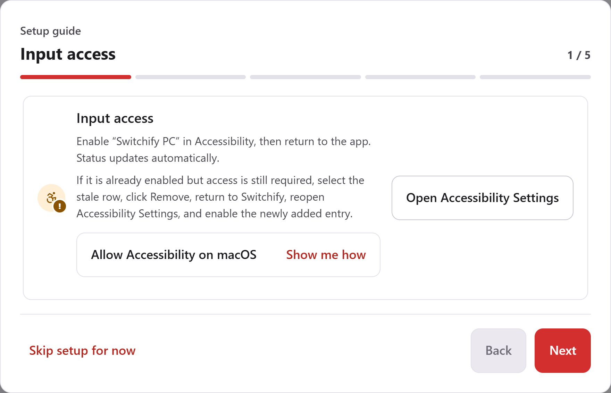
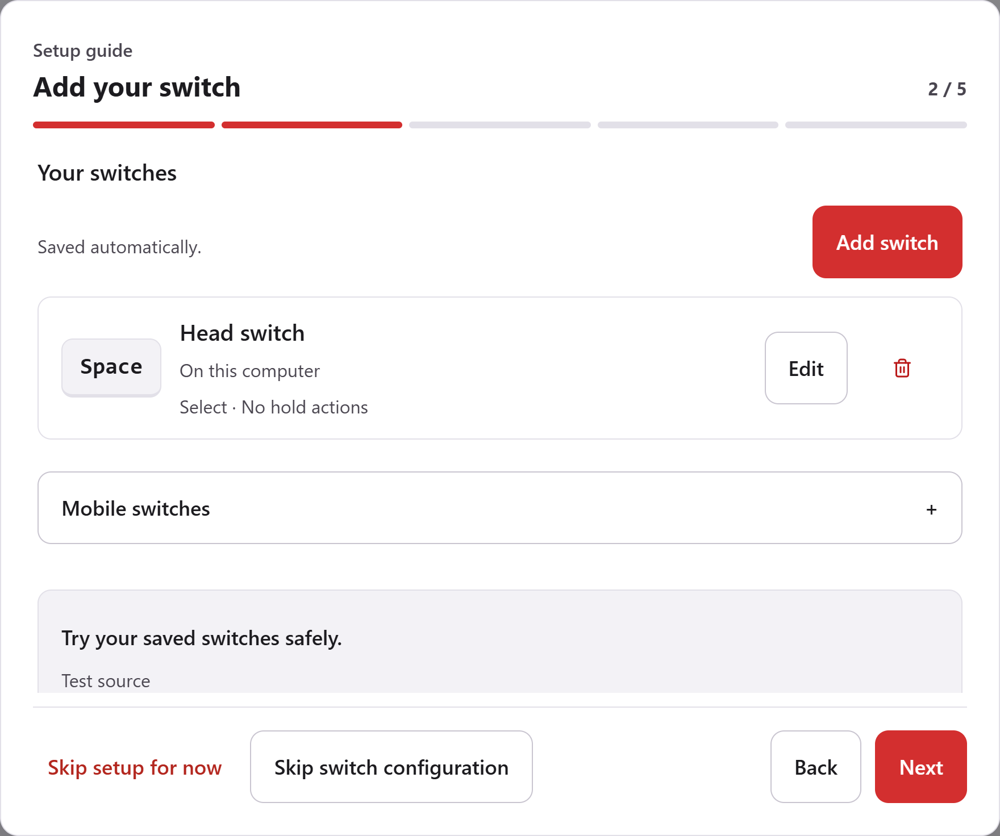
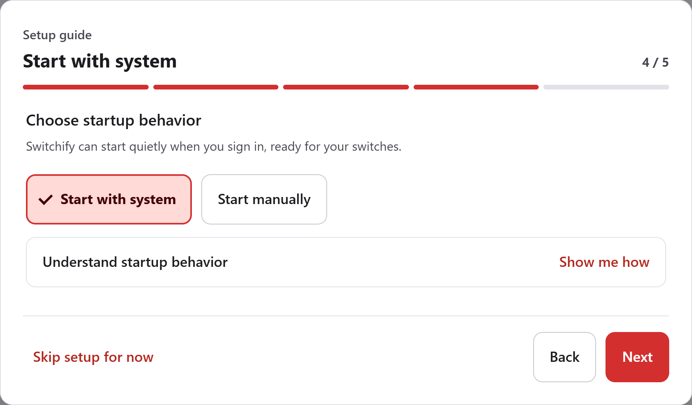
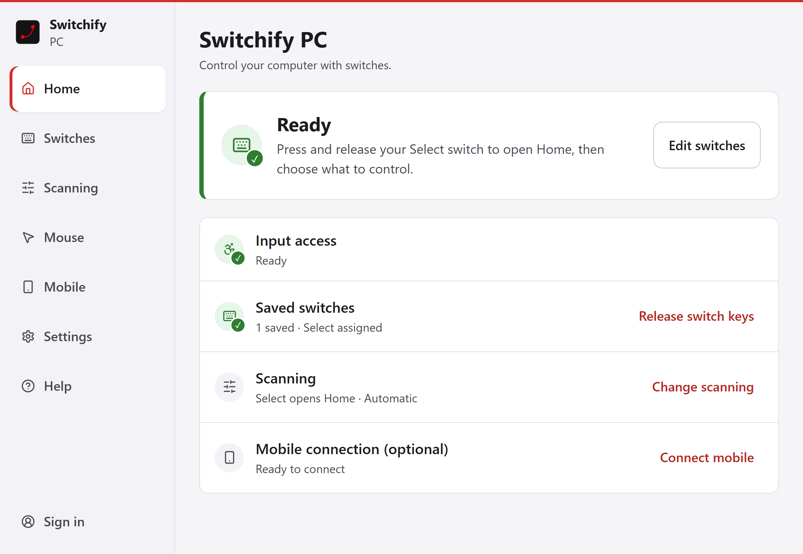

## What you need

- **Windows:** Windows 10 or later.
- **Mac:** A Mac with an M1 chip or later (Apple silicon) on macOS 13.3 or later. Intel Macs are not supported.
- **Bluetooth Low Energy**, only if you want to pair with Switchify on Android.
- **A switch** that reaches the computer as a key press, through a switch interface or a USB switch. See [Add a switch](/get-started/add-a-switch/).

Linux is not supported.

## Install

Download the latest release from [GitHub releases](https://github.com/switchifyapp/switchify-pc/releases).

- On Windows, run the installer.
- On a Mac, open the disk image and drag Switchify PC to Applications.

## The setup guide

The first time Switchify PC opens, a five-step guide walks you through:

1. **Input access.** On a Mac, Switchify PC needs Accessibility permission to control the pointer and keyboard. Choose *Open Accessibility Settings*, turn on Switchify PC under Privacy & Security, then come back to the app. It checks again by itself when its window regains focus. On Windows this step shows *Ready*.

   

2. **Add your switch.** Choose **Add switch**, press your switch once so Switchify PC learns the key it sends, then name it. [Add a switch](/get-started/add-a-switch/) shows each part of this. **Next** turns on once a switch is saved. To set switches up later, choose **Skip switch configuration**.

   

3. **Scanning basics.** A short introduction to automatic scanning and the Home menu.
4. **Start with system.** Choose **Start with system** or **Start manually**. With Start with system, Switchify PC starts quietly when you sign in, in the system tray on Windows or the menu bar on a Mac.

   

5. **Anonymous diagnostics.** Choose **Share diagnostics** or **Don’t share**. Nothing is shared unless you choose to. See [Account, updates and privacy](/account-and-privacy/).

You can skip the guide with **Skip setup for now** and reopen it later from Help.

## When setup is done

Home shows **Ready** when Switchify PC is waiting for your switches. Press and release your Select switch to open the Home menu.

The pages of the app are listed in the sidebar. In a narrow window the sidebar folds into a **Menu** button at the top that shows the current page; press it to choose another page, and press Escape or click elsewhere to close the list.

## Keeping it up to date

Switchify PC checks for an update shortly after it starts, every six hours, and whenever you ask. Settings shows what is available, downloads it, and offers *Install and restart*.

## Practise safely

Before you rely on a switch, open the switch practice area. Nothing in it clicks, types, or changes settings, so you can try presses, holds and scanning without side effects. It closes itself after two minutes.
