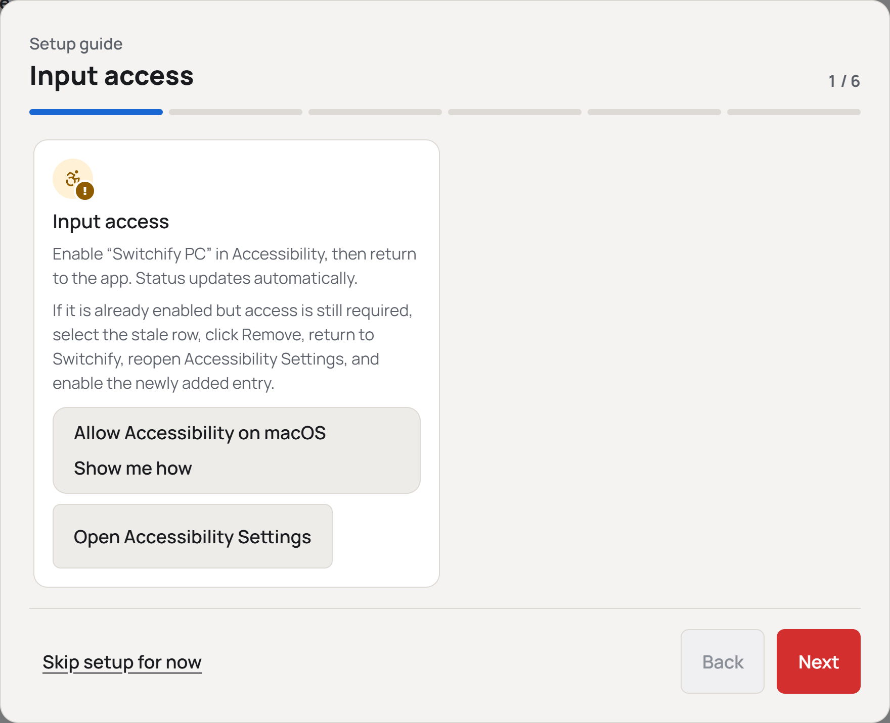
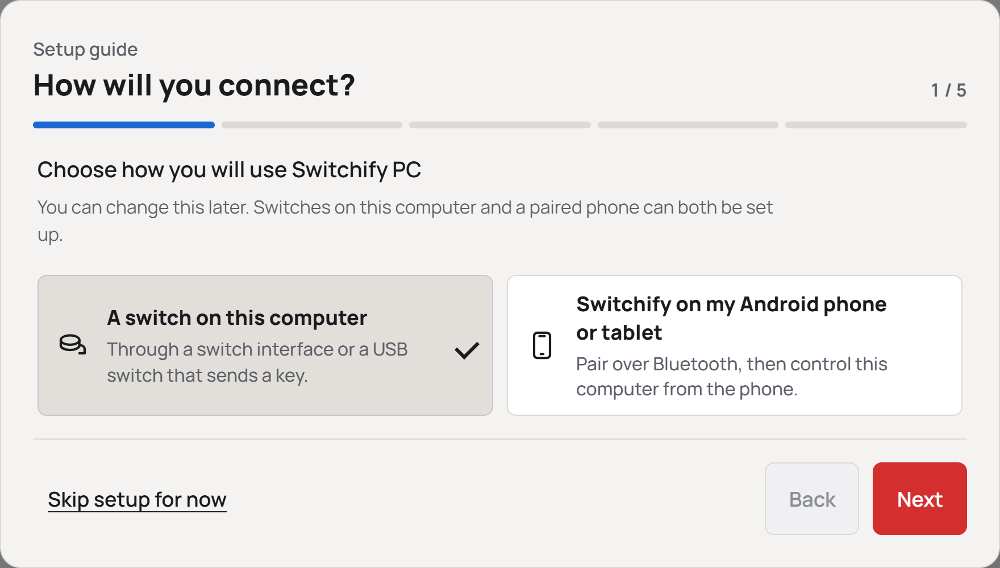
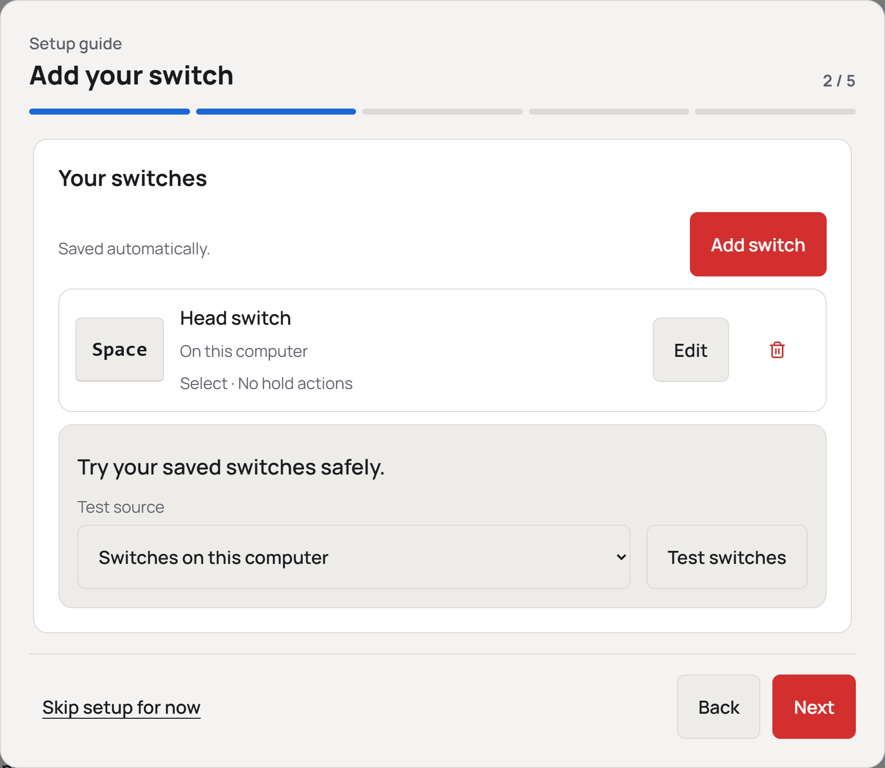
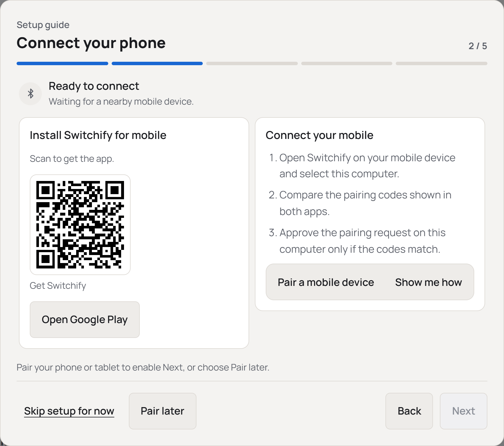
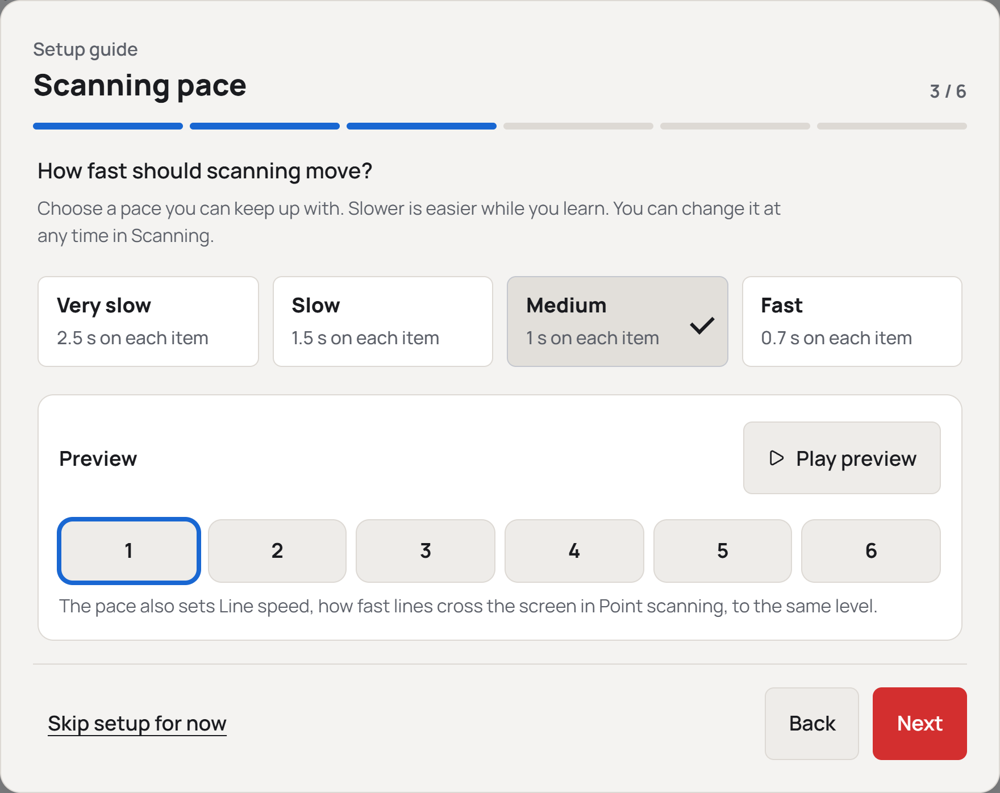
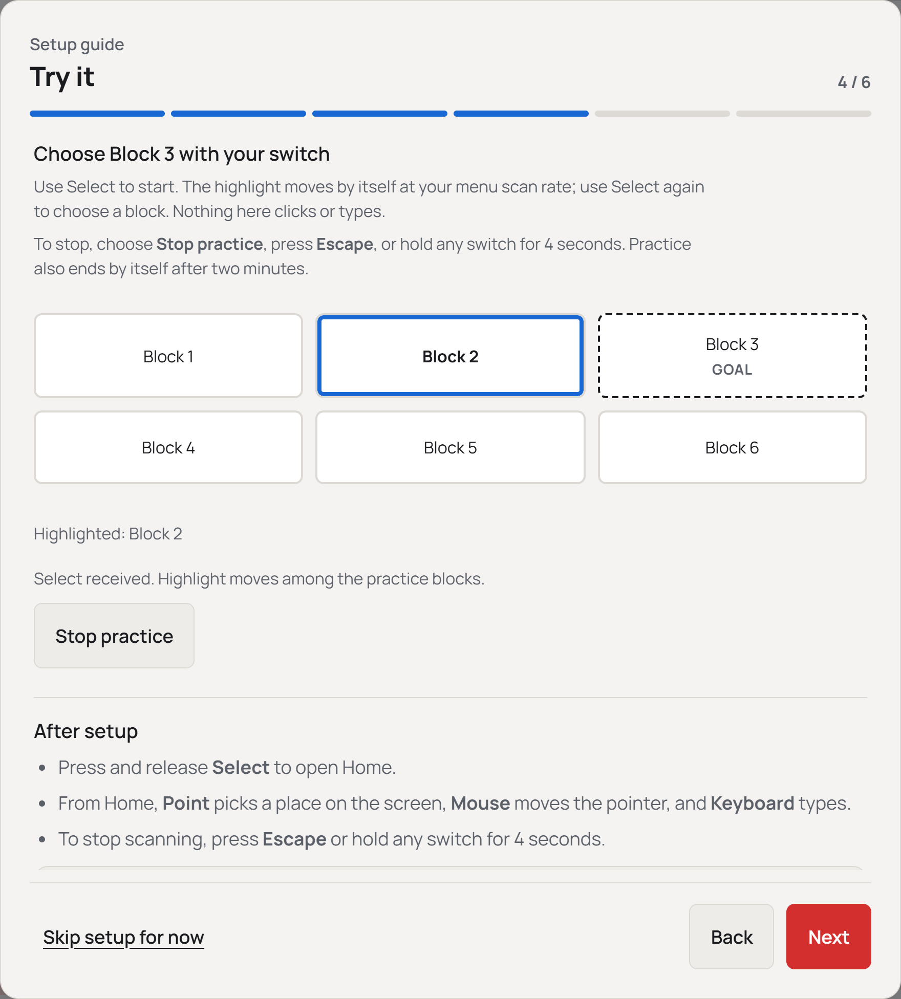
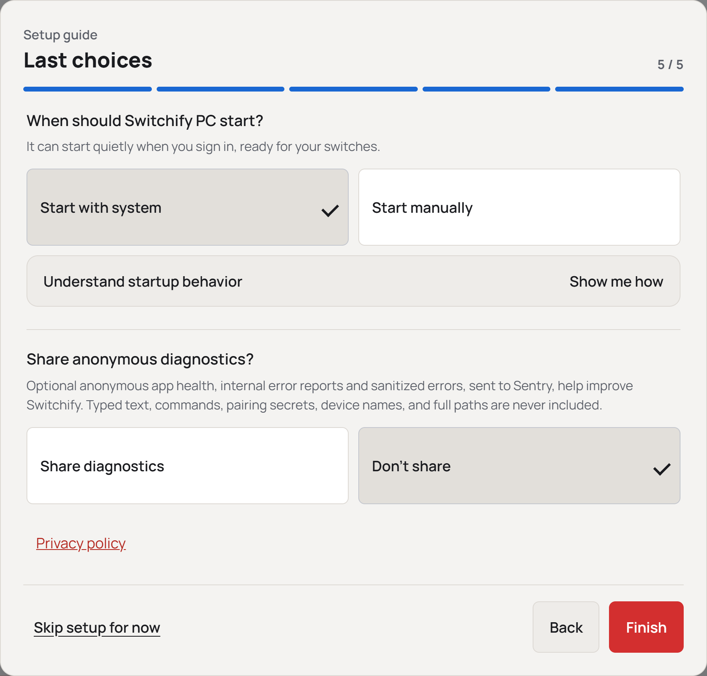
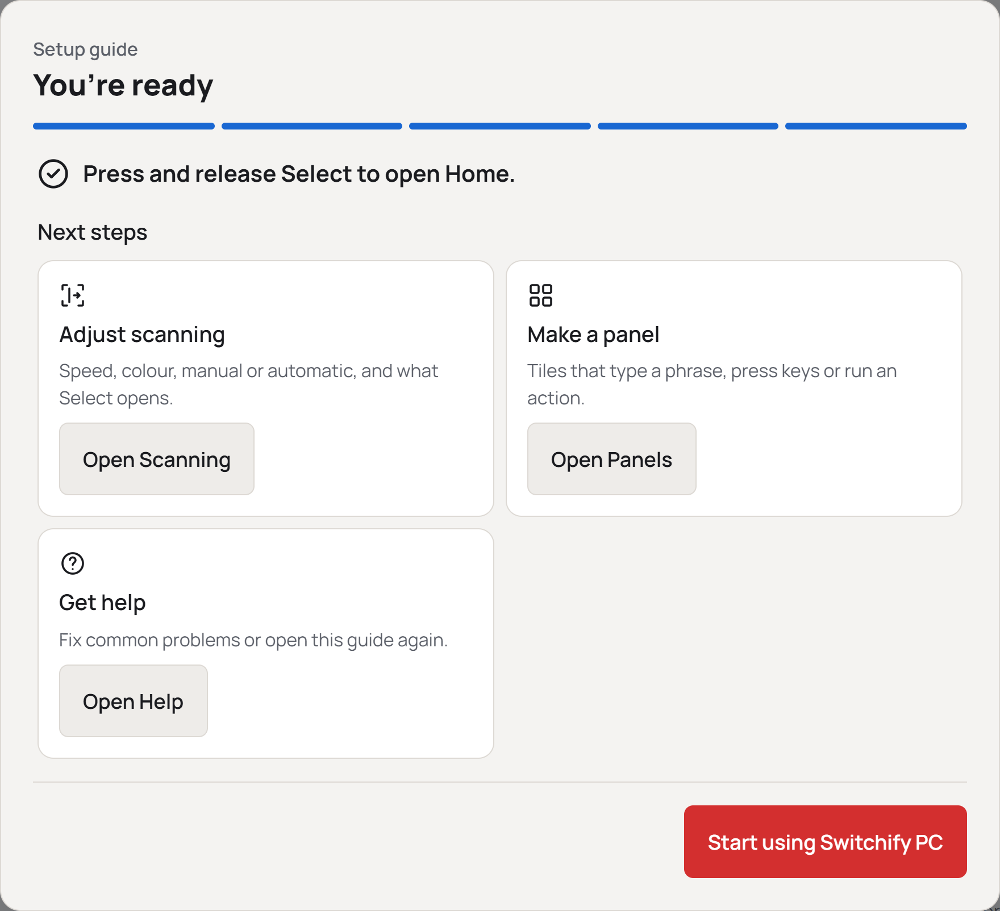
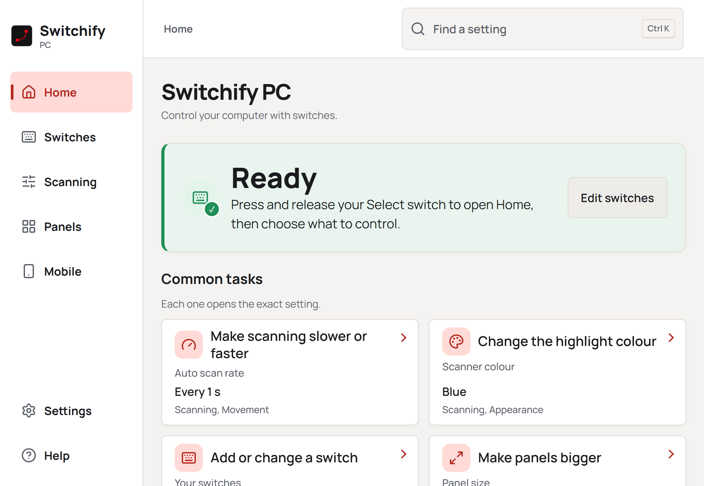
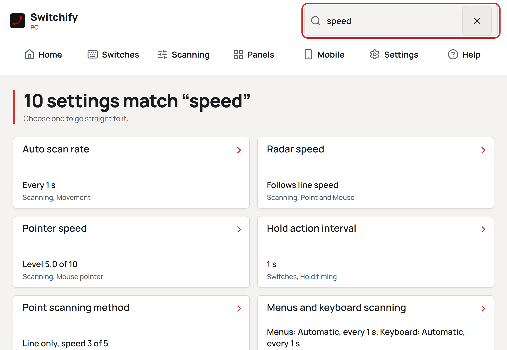

## What you need

- **Windows:** Windows 10 or later on a PC with an Intel or AMD processor, or Windows 11 on a PC with an ARM processor, such as Snapdragon.
- **Mac:** A Mac with an M1 chip or later (Apple silicon) on macOS 13.3 or later. Intel Macs are not supported.
- **Bluetooth Low Energy**, only if you want to pair with Switchify on Android.
- **A switch** that reaches the computer as a key press, through a switch interface or a USB switch. See [Add a switch](/get-started/add-a-switch/).

Linux is not supported.

## Install

Download the latest release from [GitHub releases](https://github.com/switchifyapp/switchify-pc/releases).

Already installed? Update from **Settings**, **Updates**, **Check for updates**.

- On Windows, run the installer. There are two, so pick the one for your PC's processor:
  - The file ending in `x64-setup.exe` is for PCs with an Intel or AMD processor. Most Windows PCs have one of these.
  - The file ending in `arm64-setup.exe` is for PCs with an ARM processor, such as Snapdragon.

  Not sure which you have? Open **Settings**, **System**, **About**, and look at **System type**. "x64-based processor" means the x64 installer; "ARM-based processor" means the arm64 installer.
- On a Mac, open the disk image and drag Switchify PC to Applications.

### If you installed the x64 version on an ARM PC

Before version 1.7.3 there was only an x64 installer, and it runs on Windows 11 ARM PCs through Windows emulation. That copy keeps working and keeps updating to new x64 versions. To change to the ARM version, uninstall Switchify PC from **Settings**, **Apps**, then run the `arm64-setup.exe` installer.

## Trial and upgrading to 1.4.0

Version 1.4.0 introduces a full 30-day trial and purchase licences for one
computer. If you upgrade from an earlier free release, your trial starts when
you first open the licensing-enabled app. You can see the days remaining in
the **Licence** section under **Settings**, **Account and licence**.

To continue after the trial, import your purchase email's licence attachment
or paste its key in that section. First activation needs an internet connection;
a Switchify account is not required. Each successful licence check then allows
up to 30 days offline. If that allowance ends, reconnect and choose **Check
licence now**. Settings and licence entry stay available when control is locked.
See [licences, activation and offline access](/licence/) for the full details.

## The setup guide

The first time Switchify PC opens, a guide walks you through:

1. **Input access.** On a Mac, Switchify PC needs Accessibility permission to control the pointer and keyboard. Choose *Open Accessibility Settings*, turn on Switchify PC under Privacy & Security, then come back to the app. It checks again by itself when its window regains focus. This step appears only on a Mac that still needs permission. After permission is granted, the guide continues to the next step.

   

2. **How will you connect?** Choose **A switch on this computer** if your switch is plugged in through a switch interface or a USB switch, or **Switchify on my Android phone or tablet** if you control the computer from Switchify on Android. You can set up the other one later. The phone choice is unavailable, and says why, on a computer without the Bluetooth features Switchify PC needs or when Bluetooth could not start.

   

3. **Add your switch** or **Connect your phone**, depending on your choice.
   - **Add your switch.** Choose **Add switch**, press your switch once so Switchify PC learns the key it sends, then name it. [Add a switch](/get-started/add-a-switch/) shows each part of this. This step shows only your switches. Timing, hold timing and switches forwarded from a phone are in **Switches** after setup. **Next** turns on once a switch is saved. To set switches up later, choose **Set up switches later**.

     

   - **Connect your phone.** Shows whether this computer is ready to pair, a QR code to get Switchify from Google Play, and the pairing steps. When a pairing request appears, check that the codes match before you approve it. **Next** turns on once a device is paired. To pair later, choose **Pair later**; pairing is always on the **Mobile** page. See [Pair your device](/android/pairing/).

     

4. **Scanning pace.** Choose how fast scanning moves: **Very slow** (2.5 seconds on each item), **Slow** (1.5 seconds), **Medium** (1 second, the usual pace) or **Fast** (0.7 seconds). A demo below the choices moves a highlight at the chosen pace; **Pause demo** stops it. Each pace also sets **Line speed** for Point scanning to the same level. Change either at any time in **Scanning**, where other timing settings, such as extra time on the first item, also apply. If the Home menu, Point scanning, the keyboard or the mouse panel has its own scan rate in Scanning, the step says so: a pace here does not change it. If your computer prefers reduced motion, the demo starts paused; choose **Play demo** to watch it. This step is left out if you chose to connect a phone, because Switchify on Android has its own pace.

   

5. **Try it.** Choose **Start practice**, press **Select**, and choose **Block 3** with your switch. The practice blocks scan the way the Home menu will: with automatic scanning the highlight moves by itself at your pace, and with manual scanning you move it with **Next** and **Previous**, which then need switches of their own. Like the menu, the highlight stops after its passes; press **Select** to start it again. Block 3 is marked **Goal**. Nothing in practice clicks or types. To stop, choose **Stop practice**, press **Escape**, or hold any switch; practice also ends after two minutes, when a pairing request appears, when Switchify PC is no longer the active window, or when you leave the step. The guide tells you when you have chosen Block 3, or which block you chose instead so you can try again. Below the practice, a short list says how to open Home after setup and how to stop scanning. If you chose to connect a phone, this step says how to start PC control from the phone instead.

   

6. **Last choices.** Two choices on one step, and **Finish** turns on once you have made both:
   - **Start with system** or **Start manually**. With Start with system, Switchify PC starts quietly when you sign in, in the system tray on Windows or the menu bar on a Mac. On a Windows administrator account, Windows asks for permission each time it starts, which a switch user may not be able to answer. See [For IT staff](/get-started/managed-computers/#for-it-staff).
   - **Share diagnostics** or **Don’t share**. Nothing is shared unless you choose to. See [Account, updates and privacy](/account-and-privacy/).

   

7. **You’re ready.** After **Finish** saves your choices, the guide says what to do next, such as pressing Select to open Home. It also offers shortcuts to **Scanning**, **Panels** and **Help**. Choose **Start using Switchify PC**, or press **Escape**, to close the guide, or choose a shortcut to close it and open that page. Your choices are already saved.

   

You can skip the guide with **Skip setup for now** and reopen it later from Help.

## When setup is done

Home shows **Ready** when Switchify PC is waiting for your switches. Press and release your Select switch to open the Home menu.

The sidebar on the left opens Home, Switches, Scanning, Panels, Mobile, Settings and Help. The current page has a red background and a short marker beside it. The sidebar and search bar stay available while you scroll. In a very narrow window, the page buttons move above the workspace. Scanning choices keep your chosen scanner colour and thickness.

## Finding a setting

- **Find a setting** is the box beside the page tiles. Type a word such as *speed*, *colour*, *phone*, *switch* or *licence* and matching settings appear, each with the page and section it lives in and what it is set to now. Spelling does not have to be exact, and everyday words work: *phones*, *colr* or *quicker* still find the setting. Choose one to go straight to it; it is outlined for a moment so you can see where you landed. Pressing **/** puts the cursor in the box.
Find also understands what you mean: *my scan is too quick* finds Auto scan rate, and this runs on your computer with nothing sent anywhere.

- **On this page** is the row of tiles at the top of each page, one per section, showing what each section is set to. Choose one to scroll to that section.
- **Common tasks** on Home opens the settings people most often look for, such as making scanning slower or faster, changing the highlight colour, adding a switch or making panels bigger.
- **Recently changed** on Home lists the last settings you changed, so you can find them again. It starts empty each time the app opens.
- **Also see** at the end of each page lists related settings on other pages.

## Keeping it up to date

Switchify PC checks for an update shortly after it starts, every six hours, and whenever you ask. Settings shows what is available, downloads it, and offers *Install and restart*. You can still check again while an update is waiting, and if a newer one has come out, Switchify PC offers that instead.

## Practise safely

Before you rely on a switch, open the switch practice area: the setup guide's **Try it** step, or **Test switches** in **Switches**. Nothing in it clicks, types, or changes settings, so you can try presses, holds and scanning without side effects. Practice follows your Home menu's scanning: with automatic scanning the highlight moves by itself at your auto scan rate, and with manual scanning **Next** and **Previous** move it. It closes itself after two minutes.
