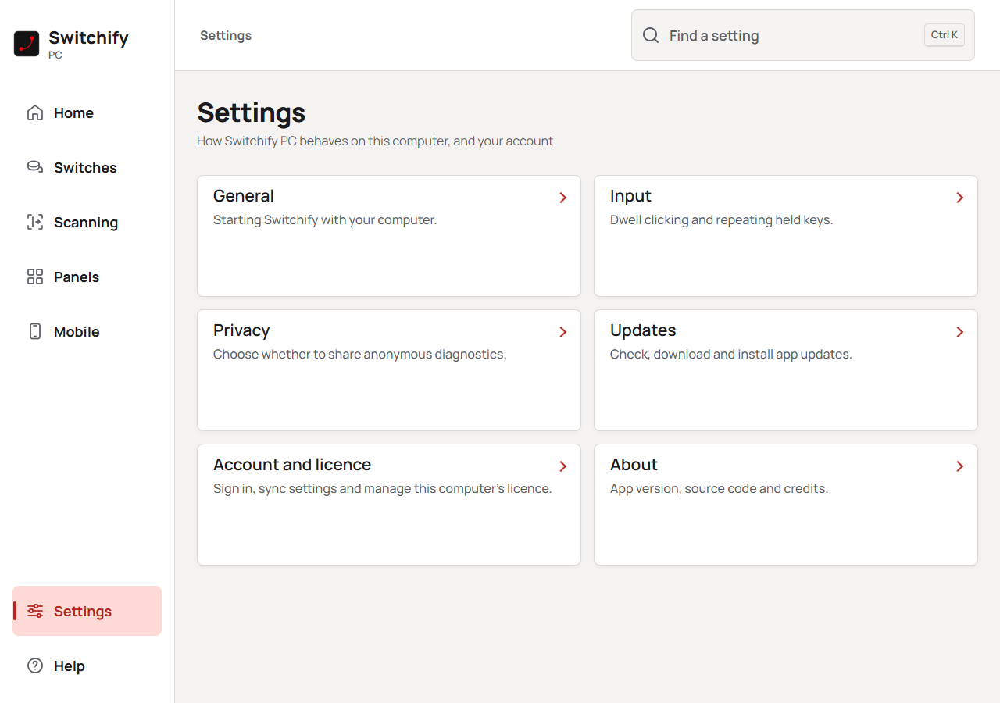

Switchify PC lets you use a Windows PC or a Mac with one or more switches. It runs on the computer itself. You can also pair it with Switchify on an Android phone or tablet to control the computer from there.

It is open source under the AGPL-3.0. See [licences, trial and purchase keys](/licence/).

## What you can do with a switch

- **Point anywhere.** A line sweeps across the screen, then down it. Press to stop each one, and a menu offers click, double click, right click, drag and scroll. Narrow it first with a grid if you prefer.
- **Open menus for the things you do every day.** Switch and close windows, copy and paste, go back and forward in the browser, play and pause media, and change volume, all from a scanning menu that opens on a press.
- **Type.** Switchify PC has its own scanning keyboard with word prediction that runs on the computer. Nothing you type leaves it.
- **Move the pointer step by step** from a mouse panel, or send it out across the screen with Radar.
- **Make panels of your own.** A panel is a page of tiles that scans like Home: each tile types a phrase, presses keys, runs an action or opens another panel. Build them in the Panels section and open them from Home. Home and the built-in menus can be rearranged there too, and the mouse panel and keyboard can take rows of your own tiles. See [Panels](/using/panels/).
- **Find any setting.** Type a word such as *speed* or *colour* into **Find a setting** and go straight to it. Section buttons at the top of a page take you to its controls, and Home lists common tasks.
- **Set the pace.** Automatic or manual scanning, the scan rate, how many passes before it stops, highlight colour and thickness, and panel size are all yours to change.

## New in v1.7.3

Switchify PC now has a Windows installer for PCs with an ARM processor, such as Snapdragon, so it no longer needs Windows emulation on those PCs. See [Install](/get-started/install/) to pick the right installer.

## New in v1.7.2

The Windows tray and Mac menu bar now use a single-colour Switchify icon that follows the system light or dark setting.

## New in v1.7.1

This maintenance update includes a fix for Mac Bluetooth connection handling and updated dependencies.

## New in v1.7.0

Assign a switch press or hold action to open one of your panels. Settings now opens a category menu, so you can view one group of controls at a time. Dialogs and confirmations use consistent keyboard focus and navigation.

## Using the settings window

The pages are in a sidebar on the left, with an icon beside each name. **Switches** has a round switch with a cable, **Scanning** has a moving line, and **Settings** has sliders. The sidebar and **Find a setting** at the top stay available as you scroll. Settings and Help sit at the bottom of the sidebar. In a very narrow window, the pages move above the workspace. The current page has a red background and a short marker beside it. Chosen settings have a filled background and a checkmark.

Press Ctrl+K on Windows or Command+K on Mac to focus **Find a setting**. You can also press `/` when you are not typing in a field. Settings show their names beside an **On** or **Off** control, and saved switches appear as rows with their edit and remove buttons alongside.

Home shows whether switch control is ready, followed by common tasks such as changing the scan rate or adding a switch. **Your setup** below them shows saved switches, scanning and the optional mobile connection. Input access appears on Home, in Help and in search only when a Mac still needs Accessibility permission. The same switch, scanning, panel and phone symbols appear beside related tasks, status information and device lists throughout the settings window.

**Settings** opens a menu of categories: **General**, **Input**, **Privacy**, **Updates**, **Account and licence**, and **About**. Choose a large category button to see its controls. Only that category is shown. Choose **Back to settings** to return to the menu; keyboard focus returns to the category you opened. Choosing **Settings** in the sidebar also returns to the menu. Builds without accounts show **Licence** instead of **Account and licence**. Changes save as you make them.

Type into **Find a setting** to find a control by name or meaning. While meaning-based search starts, the window shows **Finding settings…** if there are no keyword matches yet. Choose a result to open its setting, including the right Settings category. Clearing the search returns to the category you were viewing and keeps keyboard focus in Find.

Right-clicking in the Switchify PC window does not open a menu. To copy or paste in a text field, use Ctrl+C or Ctrl+V on Windows, or Command+C or Command+V on Mac.

## Two ways to connect a switch

**On the computer.** Plug a switch into a switch interface or a USB switch that sends a key. Add it in Settings, press it once so Switchify PC learns the key, and give it an action such as Select. See [Add a switch](/get-started/add-a-switch/).

**From Switchify on Android.** Pair the phone or tablet you already control with Switchify over Bluetooth. Then control the computer from the phone, or forward the switches connected to the phone to the computer. See [Pair your device](/android/pairing/).

## Get it

- [Download Switchify PC from GitHub releases](https://github.com/switchifyapp/switchify-pc/releases): Windows installers for Intel or AMD (x64) and ARM PCs, and a Mac disk image.
- [Install](/get-started/install/) walks through the first-run setup.
- The marketing site is at [www.theswitchify.app](https://www.theswitchify.app/pc).
