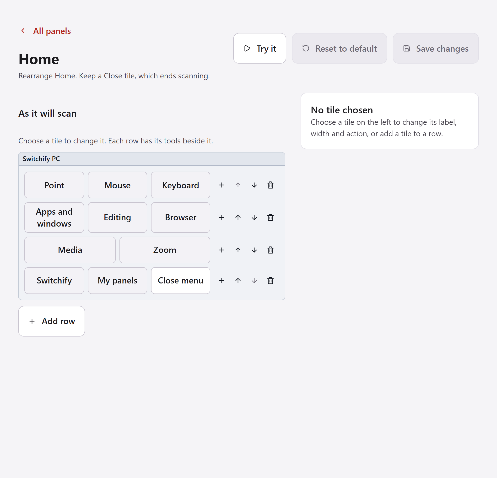

A panel is a page of tiles that scans like the Home menu. Each tile does one thing when you choose it: presses keys, types a phrase, runs an action such as Copy or Play, opens the keyboard, the mouse panel or a built-in menu, or opens another panel of yours. The panel stays open after each action so you can choose the next one, until you choose a tile that goes **Back** or closes it.

Choose the **Panels** tile at the top of the Switchify PC window to see your panels. Each one is shown as a small picture of the panel, drawn the way the scan will draw it, in the light or dark panel theme you chose in Scanning settings.

Below them, **Built-in menus and panels** lists everything else that scans, one row each, under the menu that opens it, so you can see what belongs to what:

- **On Home**: the Home menu, then the mouse panel, the keyboard and the menus Home opens: Apps and windows, Editing, Browser with Tabs under it, Media and Zoom.
- **On More actions**: More is a tile on the page that opens after you choose a point. Its menu opens most of Home's menus too, so those stay under Home and say **Also on More**; here are More itself and the three menus Home does not open: Mouse, Displays and Scanning.

## Make a panel

Choose **New panel**. Switchify PC makes a starter panel with four tiles: Keyboard, Mouse, Back and Close, and opens it in the editor. Give it a name and, if you like, a description. Names must be different from each other.

To change a panel later, choose its picture in the list. **Delete panel** removes it; Switchify PC asks first. In the confirmation, **Keep editing** is focused first. Choose **Keep editing** to cancel deletion. Tab and Shift+Tab stay within the dialog.

## Edit the tiles

The editor draws the panel as it will scan. Wide pictures scroll sideways while you edit so the tiles stay large enough to choose. Choose a tile on it to change it on the right:

- **Label** is the word or two written on the tile. Keep it short so it fits.
- **Width** makes a tile two, three or four times as wide as a normal tile. The tiles in a row share the row's width between them.
- **Action** is what the tile does. Search the list by what you want, for example "copy", "volume" or "new tab", and choose an action. Some actions need a little more: **Press keys** asks you to press the keys on your keyboard, **Type text** asks for the text, and **Open one of my panels** asks which panel.

Beside each row are its tools: add a tile to it, move it up or down, or remove it. Column tools sit below the picture, labelled **Column 1**, **Column 2**, and so on. **Add row** under the panel adds a row. With a tile chosen, the arrows move it along its row, **Row** moves it to the end of another row or a new one, and **Remove tile** takes it away. Nothing changes on the scanned panel until you choose **Save panel**; if you leave with unsaved changes, Switchify PC asks first.

If something stops the panel saving, such as a tile with no label or a link to a panel that no longer exists, a note under the buttons says what and where. Choose the note to go to that tile.

## Try a panel

**Try it** opens the panel in the scanner straight away, as it would open from Home, so you can see and use it without leaving the editor. The Switchify PC window goes out of the way first, because the tiles act on whatever window is in front. Save first: Try it uses the panel as it was last saved, so it is off while there are unsaved changes. To come back to the editor, choose **Switchify** on Home (Back takes you there from a panel), or Switchify PC on the taskbar or in the Dock. Built-in menus, the mouse panel and the keyboard can be tried the same way. If the panel is open in the scanner when you save, it changes there and then, scanning again from the top. The mouse panel and the keyboard take new tiles the same way, unless the pointer is being moved or scrolled at that moment; then they change when the panel is next opened. A panel you delete closes, and the page it opened from is shown instead: Home, when you were trying it.

## What a tile can do

- **Typing**: press keys such as Enter, Tab or an arrow, press a shortcut such as Ctrl and S, or type a phrase.
- **Editing**: copy, cut, paste, select all, undo, redo, save, find.
- **Apps and windows**: switch app forward or backward, app overview, show desktop, minimise, maximise or restore, close window.
- **Browser**: back, forward, reload, tabs, address bar, zoom.
- **Media**: play or pause, next and previous track, volume, mute.
- **Mouse**: left, double and right click, or scroll, where the pointer is. Modified clicks such as Shift-click act there too. A panel opened from the page after you choose a point acts at that point instead.
- **Panels and menus**: open the keyboard, the mouse panel, point scanning, the Switchify window, a built-in menu such as Editing, the list of your panels, or another panel of yours; Back; Close.
- **Scanning**: pause, reverse direction, faster or slower scanning, point scanning mode, keyboard layout, next or previous display.
- **Power**: shut down or restart the computer. A power tile acts as soon as it is chosen, so give it a row of its own or put it behind a link; open apps may still ask you to save.

Actions act on the window in front, as Home does. A tile that opens a panel you have since deleted says so when chosen.

Your panels are saved on this computer. If you sign in to your account, they go to your other computers with your settings.

## Rearrange the built-in menus

Home and the menus it opens, More actions and the menus it opens, and Tabs inside Browser can all be rearranged. Choose a menu's row to open it in the same editor and move, add or remove its tiles, change their labels, or give a tile a different action. The menu keeps its name. Choose **Save changes** and the next scan uses your arrangement; the row then says **Rearranged**.

Two rules keep a menu usable: it must keep a tile that goes **Back** or closes it, and Home must keep a tile that closes it, which ends scanning. The editor says so and keeps Save off until the rule is met.

**Reset to default** puts a menu back the way it came. Switchify PC asks first.

The Shut down and Restart pages, the page of clicks that appears after you choose a point, and the mouse panel's own pages cannot be changed. More actions, reached from that page of clicks, can.

Rearranged menus are saved on this computer and, if you sign in to your account, go to your other computers with your settings.

## Add tiles around the mouse panel's and the keyboard's keys

**Mouse panel** and **Keyboard** in the On Home list are the two scanning panels with their keys. The keys cannot be changed, but you can add tiles of your own around them: a phrase you type often, a shortcut, or a link to one of your panels. Choose a panel, then **Add row** for a row below the keys or **Add column** for a column beside them, and give each tile a label and an action as on any panel. The keys are drawn faintly and cannot be chosen; your tiles sit among them where they will scan, with each row's tools beside it and each column's tools under it. With a tile chosen, **Row** or **Column** on the right moves it to another row or column, or a new one. Choose **Save changes**; the row then says what you added.

Up to four rows fit below the keys, and each row shares the panel's width between its tiles, as on your own panels. Up to two columns of up to six tiles run down the right of the keys from the top row; a column longer than the panel adds rows of its own below it, and a column is as wide as its widest tile.

The rows appear on the mouse panel's Movement page and on every keyboard page, just above the bottom row; the columns appear on the same pages, to the right. All of them scan like the rest: a column's tiles are the last in their rows. A tile acts as it does on your panels. On the keyboard, a tile that types waits for the text to land before scanning on, like a key. **Back** and **Close** leave the panel: from the keyboard they close it, and from the mouse panel they switch to point scanning, as its own Switch to Point key does. A tile that opens a menu or one of your panels from the mouse panel comes back to it with Back; from the keyboard, Back goes to Home.

**Remove tiles** takes the panel back to its keys alone. Switchify PC asks first.

Added tiles are saved on this computer and, if you sign in to your account, go to your other computers with your settings.

## Open a panel

Press Select to open Home. Once you have made a panel, Home has a **My panels** item beside Switchify. Choose it to see your panels by name, then choose one to open it. The same item sits beside Close menu on the page that opens after you choose a point and on the mouse panel's Actions page, so your panels are one choice away from anywhere.

On a panel, **Back** returns to the list, and from the list Back returns to the page you came from: Home, the point's page or the mouse panel's Actions page. **Close** ends scanning, as Close menu does on Home.

If a tile opens a panel you have since deleted, a short message says the panel no longer exists and the current panel stays open. Press Select to carry on.
